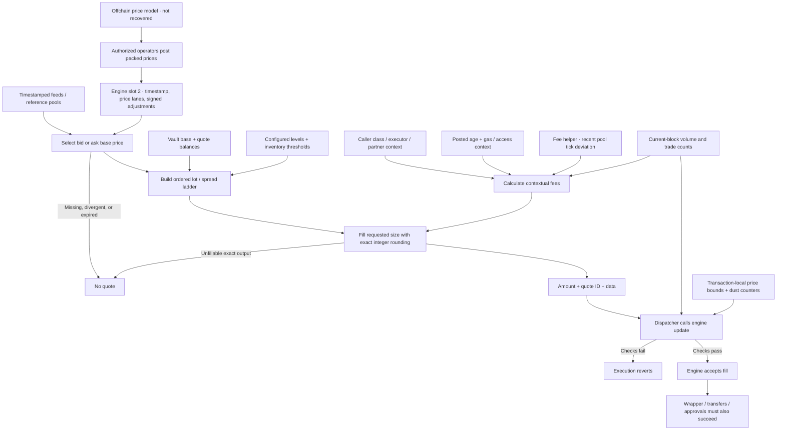

# ElfomoFi pricing engine architecture

This describes the reconstructed Base engine at
[`0x84cb…654ae`](https://basescan.org/address/0x84cb1a96e57e9b88cf75035384c06dc3769654ae#code)
and its [fee helper](https://basescan.org/address/0x42e88fbc20c66bfe4bac17892980b640990d8cbc#code).
Both runtime executables and all 29,600 executable creation bytes match stock
Solidity 0.8.34 output. The two original metadata hashes remain different.
Names in the reconstruction are analytical labels. Routing and mutable parameters
can change; these conclusions are scoped to this version and captured configuration.

## From a posted price to a fill

This is the ordinary flow. Privileged origins have separate price, fee and update
branches. A public order-book response stops before caller-specific quote handling
and execution checks; it is not a universal executable depth curve.

## Contracts and responsibilities

| Component | Responsibility |
| --- | --- |
| Swap wrapper `0xf0f0…d5f73` | External trading entry point; outside the new simulator's settlement scope |
| Pricing proxy `0xffffffbb…1d038` | Routes pairs to an engine and participates in caller classification |
| Engine `0x84cb…654ae` | Posted/reference prices, ladders, fees, exact quotes, administration and execution guards |
| Vault `0xbb1b…e0c99` | Token inventory queried by the engine |
| Helper `0x42e8…d8cbc` | WETH/cbBTC reference-pool observation adjustment |
| References and classifier | External inputs; their full strategy and class identities are not recovered here |

## State and control flow

| Engine storage | Recovered use |
| --- | --- |
| Slot 0 | Per-token level configuration |
| Slot 1 | Side counters used by the small-trade branch |
| Slot 2 | Shared timestamp plus per-token packed price / signed adjustment |
| Slot 3 | Sell-side statistics keyed by token and block |
| Slot 4 | Buy-side statistics keyed by token and block |
| Slot 5 | Token metadata: decimals, reference mode, lots and inventory thresholds |
| Slot 6 | Supported-token array |
| Transient storage | In-transaction price bounds and special-origin adjustment |

The constructor validates configuration, embeds dependencies and creates the helper.
The owner and twenty embedded operators can post prices. The posted-price model,
external hedging and operator key management are not in this contract.

The main reconstructed source entry points are `getOrderbook`, `getAmountOut`,
`getAmountIn`, `update`, metadata/pair getters, administration, and packed-price
fallback. [EngineState.sol](src/EngineState.sol) preserves the matching source.

## Pricing rules that matter in practice

| Mechanism | Observed rule | Interpretation / limit |
| --- | --- | --- |
| Reference validation | Depending on mode and freshness, reject excessive deviation or select conservative bid/ask prices | Consistent with limiting exposure to a stale or bad posted price |
| Inventory | Asks use base holdings and reserve rules; bids use quote funds and an inventory threshold | Explains asymmetric depth without establishing a directional market view |
| Freshness | Captured public-book penalty is 25 / 35 / 45 bps at age greater than 6 / 8 / 10 seconds; no quote beyond 15 seconds | Exact quotes can use discounted fee age when a 1,000-gas self-call succeeds |
| Caller classes | 44 enum values; some fees depend on size, inventory and `gasleft()` | Class numbers do not identify particular firms or flow quality |
| Pool helper | On valid observations with the latest timestamp equal to block time, fee is `min(abs(currentTick - intervalAverageTick) + 1, 100)` bps per side | Consistent with protecting against recent pool moves; not a fixed-duration TWAP |
| Same-block volume | `min(ceil((priorSameSideVolume - lot) / lot) * 2, 10)` bps when prior volume exceeds one lot and the new amount is nonzero | More same-side flow can worsen the next quote |
| Trade-count adjustment | A separate count-squared adjustment to the raw quoted amount, subject to a 1/1000 limit | Different from the volume spread |

The engine combines these with ordered lot/spread levels and exact rounding.
The fee components embedded in the quote ID are capped at 255 spread units
(25.5 bps); they are diagnostics, not an uncapped fee decomposition. Ladder spreads
and the raw count adjustment are separate.

## Execution checks

For an ordinary update, the **pre-trade** counters must satisfy:

- Same-side count `<= floor(15 / divisor)`.
- Same-side count of trades at least two lots `<= floor(10 / divisor)`.
- Same-side **or** opposite-side count of trades at least eight lots
  `<= floor(5 / divisor)`.

The divisor is two for pool-reference modes 3–5 with metadata `raw4 == 0`, otherwise
one. Thus a prior count of 15 can accept one additional trade with divisor one;
a prior count of 16 fails. This is not simply a hard maximum of 15 completed trades.
Large-trade conditions examine prior counts even when the proposed trade is small.

Within a transaction, transient bounds require sell ratios to remain strictly below
buy ratios. This is consistent with preventing crossed round trips. The exact
checks are recovered; strategic intent is inferred. Privileged paths differ.
Dust markers, authorization, integer bounds and arithmetic checks also apply.

## Live execution simulator

The [dashboard](https://elfomofi-depth-lab.jersey.chatgpt.site) now has an Execution
tab and an interactive Architecture tab. The portable implementation lives in
[`apps/elfomofi-depth`](../../apps/elfomofi-depth).

For each independent size, the simulator performs an `eth_call` with an ephemeral
[`ExecutionProbe`](../../apps/elfomofi-depth/contracts/ExecutionProbe.sol) replacing
the pricing proxy's code **inside that call only**. It supplies the selected caller
class to the original engine, calls its exact quote entry point, then calls `update`
with that quote and the implied input/output amounts in the same EVM execution.
It never deploys a contract, signs a transaction or persists state onchain.

The engine and helper runtime hashes and the dispatcher route are checked before
simulation. All reads and calls use one block, and its canonical hash is checked
again afterwards. The verified engine's code, helper, references and token code
are preserved. The selected class bypasses the real classifier; origin is the
swap wrapper, executor is explicit, partner is zero, and gas is explicit.

Optional experiments change only:

- The low 32 timestamp bits of engine slot 2, preserving all posted price lanes.
  Block time, references and helper observations remain captured. This can also
  change posted/reference freshness selection; it is not a forecast of future prices.
- Current-block trade statistics. Same-side counters are applied relative to each
  row's direction; the opposite large-trade count can be seeded separately. They
  are hypothetical counter values, not a replay of earlier inventory changes.
- Access warmth of the address used by the engine's limited-gas age probe. This
  lets the original EVM code choose the ordinary or reduced-age fee path.

The outputs distinguish **engine checks pass**, **no quote**, **quote reverted**,
**execution blocked**, and **RPC unavailable**. A failed update can coexist with a
nonzero quote; that amount is shown for diagnosis, never marked as passing liquidity.
Every row starts from the same state. A set of passing rows is not a sequence of fills.

The probe does not run token transfers, allowances, the original dispatcher, swap
wrapper checks or a complete settlement transaction. It does not seed earlier
transaction-local bounds. Gas-sensitive branches execute faithfully in the probe's
context, which differs from an actual aggregator transaction. Passing means the
engine accepts this proposed fill under the stated scenario, not guaranteed settlement.

Captured blocks stay pinned while changing scenarios. The UI labels unapplied
controls and compares results only at the same block hash. JSON exports preserve
raw amounts, quote IDs, selected settings, captured counters, code hashes, block
identity and the instrumentation source hash. Display decimals are not used for
contract calculations.

The probe source is compiled with the pinned stock compiler by
`node scripts/build-execution-probe.cjs`; `--check` verifies the tracked artifact.
The app has offline RPC/ABI/override regression tests and an explicit live scenario
smoke test. The original reconstruction's 15,451 engine and 156 helper differential
scenarios remain separate evidence; they are not a test count for this web UI.
