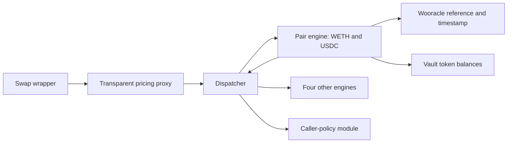

# ElfomoFi: pricing dispatcher and WETH/USDC engine

This case reconstructs ElfomoFi's 15-selector pricing dispatcher and probes its
WETH/USDC engine using captured Base bytecode and state. The dispatcher routes
11 registered pairs to five engines. The engine experiments show a posted-price
ladder shaped by inventory, external-reference checks, quote age, caller
classification and earlier executions in the block.

**Status: behavioral reconstruction, not a bytecode match.** The dispatcher is
compilable Solidity; the larger engine is only partially reconstructed. Its
original bytecode runs in the experiment harness. No source was submitted to
Basescan, and no transactions were broadcast. This is independent research, not
an official ElfomoFi release.

## Snapshot and architecture

All state is pinned to Base block **57,503,212**, hash
`0x2308f3bff4902fb89cf07af3a89e2cb03a29363d1b82febf4c71357f80f32bee`,
collected on 2026-11-14. Addresses and verification status can change after this
snapshot.

| Component | Address / evidence | Role |
|---|---|---|
| Verified swap wrapper | [0xf0f0…5f73](https://basescan.org/address/0xf0f0f0f0fb0d738452efd03a28e8be14c76d5f73#code) | Entry point; supplies the public pricing interface |
| Pricing proxy | [0xffff…d038](https://basescan.org/address/0xffffffbb2d432b8acb4c57d556c0c721a431d038#code) | Stock transparent proxy; EIP-1967 implementation slot captured |
| Unverified dispatcher | [0x555a…790b](https://basescan.org/address/0x555a998a43a63d67abfb186b375d8aa56c66790b#code) | 5,669-byte implementation reconstructed here |
| Unverified WETH/USDC engine | [0xd6ac…a3ee](https://basescan.org/address/0xd6ac027dbcbf19489e8ecd4d719aa83396eca3ee#code) | 24,268-byte engine; also serves cbBTC and another pair |
| Caller-policy module | [0x80d0…5e29](https://basescan.org/address/0x80d06229252825137f36e3484ea61c10b6235e29#code) | Returns a uint8 classification; name is an analyst label |
| External reference | [0xf9b0…8081](https://basescan.org/address/0xf9b0c8ee13ae2fc0665764ecbdb417685dea8081#code) | Wooracle timestamp and token information |
| Vault | [0xbb1b…0c99](https://basescan.org/address/0xbb1b19f138db3925883a96ff7a304277460e0c99) | Token balances used in pricing |



The proxy is verified; its dispatcher and the selected engine were unverified
when checked. Verifying a proxy shell does not reveal the pricing implementation.
The deployment [transaction](https://basescan.org/tx/0x9fff0d8c5907ed6ef7a71122c570d6051ecbd05db5fd3e403fa18b80412433ec)
and receipt are preserved. Executing that transaction's original initcode
reproduces the captured dispatcher runtime exactly.

## What the strategy appears to do

### An inventory-sensitive ladder, anchored to posted prices

Engine slot 2 packs a 32-bit timestamp and eight 28-bit lanes. Each lane contains
a 22-bit price mantissa and a signed six-bit adjustment. The WETH metadata getter
returns index 0, token decimals 18, price decimals 2, reference kind 1, a 15-valued
reference-deviation field, and a base lot of **0.6 WETH**. The complete raw getter
layout and a decoder are in [model.py](model.py); unresolved policy fields keep
raw names rather than speculative meanings.

**The actual WETH mantissa at the captured block is zero.** The original-bytecode
local replay exactly matches a pinned RPC quote of zero for 1 WETH. This is one
read at one block and caller context, not evidence that all Elfomo markets were
inactive.

To inspect the nonzero pricing branches, the experiments replace only that
mantissa with **176245**, corresponding to **1,762.45 USDC/WETH**. They retain the
captured external reference, timestamps, balances and other state unless an
experiment explicitly overrides them. These are **counterfactual local quotes,
not historical trades or executable live offers**.

With that replacement, the public orderbook path returns these bid levels:

| WETH capacity | USDC per WETH |
|---:|---:|
| 0.6 | 1,762.414751 |
| 3 | 1,761.3396565 |
| 2.125377592479649380 | 1,761.1281625 |
| 146.939965664841555788 | 881.225 |

The final bid is 50% of the anchor. The ask side has seven levels, ending at
150% of the anchor. Those terminal levels are materially different from the
normal depth near the reference. For example, selling 1, 5 and 10 WETH in this
counterfactual returns 1,761.984712, 8,807.047246 and 13,851.434284 USDC respectively.
The 10-WETH quote crosses into the deeply discounted terminal bid.

**Interpretation:** small quotes can be competitive while large or unwanted
flows receive sharply worse prices. Terminal capacities should not be mistaken
for comparable near-market liquidity. We have not established why the operator
chose these specific parameters.

### Inventory constrains the willingness to accumulate more WETH

The captured vault holds **65.674622407520350620 WETH**. Holding every other input
fixed, changing only its WETH balance changes the 1-WETH sell quote:

| Counterfactual vault inventory | USDC output for selling 1 WETH |
|---:|---:|
| 0 WETH | 1,762.407700 |
| 60 WETH | 1,762.407700 |
| 71.4 WETH | 528.735000 |
| 72 WETH | 0 |
| 84 WETH | 0 |

The observed cutoff is consistent with 120 lots of 0.6 WETH in this configuration.
It supports an inventory ceiling for this side of this market, not a universal
protocol limit. The experiment changes the token balance storage locally; it
does not deposit, withdraw, or execute a swap.

### Stale or divergent anchors become less attractive, then return zero

The captured Wooracle reference is **1,762.4551**, with a timestamp seven seconds
behind the block; the engine's posted timestamp is three seconds behind.
Replacing the posted WETH price with 1,750 or 1,770 produces zero, whereas the
sampled prices from 1,760 through 1,765 produce nonzero results. The behavior and
metadata are consistent with a 15-basis-point reference-deviation guard; the
complete boundary and rounding conditions are not proven by this sample.

With the 1,762.45 anchor, advancing only the local EVM timestamp gives:

| Added seconds | USDC output for selling 1 WETH |
|---:|---:|
| 0 | 1,761.984712 |
| 5 | 1,757.578587 |
| 10 | 1,754.053687 |
| 30 | 0 |

Both the posted-price age and external-reference age advance in this experiment.
It demonstrates combined age sensitivity, not an isolated universal timeout for
one oracle. The likely purpose is to reduce exposure to stale prices between
updates; that purpose is an inference.

### Caller classes affect price; the class is not a linear fee

The engine asks the dispatcher for a uint8 classification based on executor and
partner ID. Substituting a constant-return policy module isolates the engine's
response:

| Stubbed class | USDC output for selling 1 WETH |
|---:|---:|
| 0 or 1 | 1,761.984712 |
| 2 or 20 | 1,758.988547 |
| 10 | 1,761.279732 |
| 44, 100 or 255 | 1,761.984712 |

This shows categorical treatment rather than a monotonic numeric surcharge. It
does **not** reveal how real traders receive a category, identify any particular
trader as toxic, or establish the complete caller-policy algorithm.

### Prior executions matter within the block, including their volume

Local pricing `update` calls reduce the next quote even while token balances
remain unchanged. Transient storage is cleared between each top-level call, so
this effect is not an accidental carryover of transaction-local storage.

| Prior update sequence | USDC output of the next 1-WETH sell quote |
|---|---:|
| None | 1,761.984712 |
| One 1-WETH update | 1,761.632221 |
| One 2-WETH update | 1,760.927241 |
| Two 1-WETH updates | 1,760.927238 |
| Two 0.5-WETH updates | 1,761.632218 |
| Two 1-WETH updates, then advance block number only | 1,761.984712 |

A persistent accounting word stores a high-128-bit count and low-128-bit amount
on these paths. Doubling prior volume changes the subsequent quote substantially;
splitting the same volume into two updates changes it by only **0.000003 USDC**
in these fixtures. Advancing the block number restores the baseline while
keeping the timestamp, inventory and the recorded prior accounting unchanged.

**Interpretation:** the current engine's within-block treatment is substantially
volume-sensitive in this setting. A pure trade-count description is insufficient.
These are pricing-accounting calls, not complete swaps: unchanged balances
intentionally separate accounting effects from inventory effects. Other trade
sizes, directions and caller classes may behave differently.

## What was reconstructed

[PricingDispatcher.sol](src/PricingDispatcher.sol) covers all 15 external
selectors. Ten use selector-compatible signatures, with provenance recorded in
[selector-map.json](selector-map.json); five retain raw fallback dispatch because
their original names are unknown. No synthetic selector collisions are used.

The important storage locations are:

| Proxy slot | Meaning |
|---|---|
| 0 | Initializer version and flag |
| 51 | Owner |
| 101 | Mapping from pair key to engine |
| 102 | Array of registered token pairs |
| 103 | Caller-policy module address |

The mapping key is `uint160(tokenA) + uint160(tokenB) + K`, with
`K = 0x0146109eced2816f22a2937a116619ffffffffffff`, followed by the normal mapping
slot hash with slot 101. It is commutative, so both directions select the same
engine. [routes.json](evidence/routes.json) includes all 11 pairs, keys, storage
slots and observed words. The pair list and route mapping are separate state.

Quote, update and supported-pair methods restrict callers to the swap wrapper.
The orderbook method is public. A mapped engine can request caller classification
through selector `0x725e6ced`; other callers receive zero. Route updates are owner
restricted. The policy setter additionally accepts one hardcoded administrator;
two policy-update forwarding methods check `tx.origin` against the owner or 20
literal operators. These are observed control paths, not an ownership attribution
or a security assessment.

The independent [Python model](model.py) recovers exact-input traversal of a
supplied ladder. With base decimals 18, quote decimals 6 and price scale 1e12:

- Selling base consumes each level and adds `floor(baseUsed * price / 1e24)`.
- Buying base pays `ceil(capacity * price / 1e24)` for each complete level, then
  takes `floor(remainingQuote * 1e24 / price)` from the partial final level.

Rounding separately at each level matters. The model matches all 18 sampled
buy/sell sizes exactly. It does not reconstruct how every possible ladder is
built, exact-output pricing, or post-traversal accounting adjustments.

## Reproduce offline

From the repository root, after installing the locked Python and npm dependencies:

```sh
uv run --frozen python scripts/evidence.py cases/elfomofi-pricing
uv run --frozen python scripts/reproduce-elfomofi.py
```

The script uses stock **Solidity 0.8.34+commit.80d5c536**, via IR, optimizer runs
200 and Cancun target. The compiler version comes from deployed metadata; these
candidate settings are analyst choices. No compiler bytecode is patched.

| Validation | Result |
|---|---|
| Original initcode → captured dispatcher runtime | Exact |
| Dispatcher synthetic differential fixtures | 84/84 |
| Captured RPC quote, original and candidate dispatcher | Exact, both zero |
| Engine scenarios using original dispatcher | 65 |
| Same scenarios with candidate dispatcher substituted | 65/65 identical |
| Independent ladder arithmetic | 18/18 |
| Packed metadata decoder versus deployed getter | Match |
| Candidate runtime size | 5,957 bytes vs. original 5,669 |
| Executable / full bytecode match | Neither |
| Explorer verification submission | Not submitted |

Outputs go to `build/elfomofi-pricing/`. Synthetic dispatcher tests compare return
and revert bytes, nested calls, logs and watched storage. They use explicit
engine fixtures. The engine experiments instead execute captured original code
and token/oracle dependencies, with every deliberate override recorded in each
scenario's `spec`.

[evidence/state-witness.json](evidence/state-witness.json) contains the code and
storage read by these paths. Missing code or storage raises an error; it is not
silently replaced by empty state. The harness uses Cancun opcode semantics and
Base chain ID, not a full Base node. It does not reproduce chain-specific gas
accounting, native balances or arbitrary future paths. The RPC witness is not a
Merkle state proof. Calls are simulated without transaction signing.

## Prior research and limits

The user supplied *Active Liquidity On Chain: Evidence from PropAMMs Across
Chains*, Ozan Solmaz, Lioba Heimbach and Jason Milionis,
[arXiv:2609.38056v1](https://arxiv.org/abs/2609.38056), September 29, 2026.
Appendix D, pages 24–26, already describes Elfomo's inventory-sensitive ladders,
Wooracle checks, age and caller adjustments, and within-block penalties. Those
broad architectural findings are prior work, not novel discoveries of this lab.

The paper studies August implementations and identifies Elfomo engine
`0x611014f2cccb9d0ddb669dc0b1fa9cd005da647e`. This case captures a different engine
and dispatcher at a later block. Its equal-volume experiments refine the older
paper's trade-count description for the current tested paths. The paper omits
Elfomo's terminal level from its illustrative curve; this case preserves it in
[counterfactual-orderbook.json](expected/counterfactual-orderbook.json).

The contribution here is a reproducible later-state snapshot, a compilable
15-selector dispatcher, exact ladder arithmetic, and controlled experiments with
original engine code. It is not a recovery of the complete engine, the offchain
fair-value or hedging model, private order flow, update scheduling, realized
profitability, or the policy module's classification rules. No claim of global
behavioral equivalence or exploitable vulnerability is made.

## Evidence inventory

- `chain-*.hex`, `constructor-arguments.hex`: original deployed and creation bytes.
- `standard-input.json`: literal candidate sources and compiler settings.
- `evidence/implementation-collection.json`: deployment receipt and runtime hash.
- `evidence/proxy-*`, `routes.json`: proxy slots, code and pair routing.
- `evidence/dependencies/`: all five engine runtimes and policy-module runtime.
- `evidence/rpc-quote.json`: exact pinned `eth_call` inputs and output.
- `evidence/observed-call-tree.json`: **local** original-bytecode execution trace,
  not a provider `debug_traceCall` response.
- `evidence/witness-provenance.json`: collection methods, block and code hashes.
- `expected/`: differential outcomes, all experiment specifications, orderbook,
  bytecode comparison and validation summary.
- `manifest.json`: SHA-256 checksums of case files, checked in CI.

The Solidity dispatcher is independently reconstructed and marked UNLICENSED.
The public `IElfomoPricing` interface retains its published MIT identifier.
Neither the repository license nor this analysis claims ownership of Elfomo's
original software. See the root [NOTICE](../../NOTICE).

## Harness update, 2026-11-14

The witness harness now accepts explicit case-owned native precompile handlers.
The current-engine case needs one captured B20 `decimals()` response during its
constructor replay. This earlier case keeps the same default Cancun behavior,
fixtures and expected results; its evidence manifest is deliberately updated
for the documented harness change.
