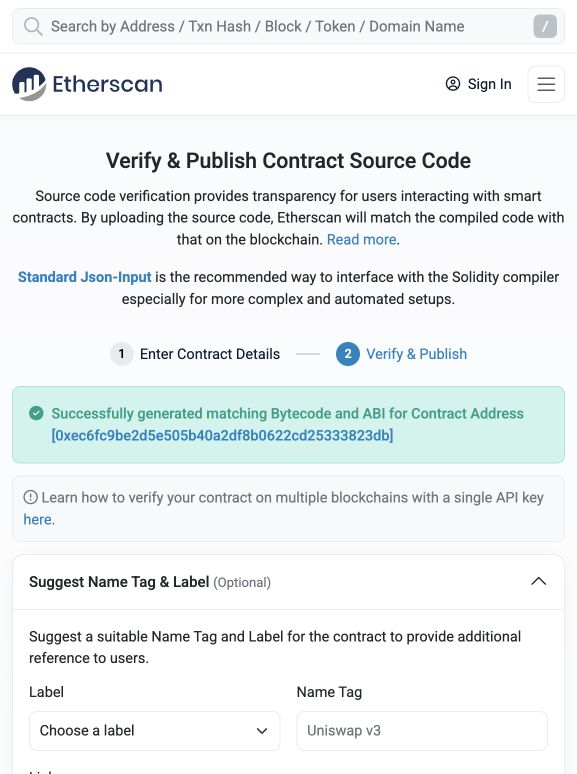

# Wintermute-associated Curve / Balancer executor

Ethereum: [`0xec6fc9be2d5e505b40a2df8b0622cd25333823db`](https://etherscan.io/address/0xec6fc9be2d5e505b40a2df8b0622cd25333823db#code)

An independent reconstruction of a permissioned, inventory-funded execution
adapter. It executes caller-selected Curve and Balancer swaps, returns proceeds
to a fixed inventory contract, and optionally attempts an ETH payment to an
approved block fee recipient. This is not an official Wintermute source release.
The association is also reported in the address table of
[CEX–DEX arbitrage research](https://arxiv.org/html/2507.13023v3#A1.T4).

## Reproduction result

From the repository root:

```sh
uv sync --frozen --extra dev
npm ci --ignore-scripts
uv run python scripts/reproduce.py wintermute-curve-balancer
```

| Property | Value |
|---|---|
| Compiler | Solidity 0.8.19+commit.7dd6d404 |
| Optimization | Enabled, 200 runs, viaIR |
| EVM compilation target | paris |
| Local execution VM | Shanghai, synthetic state |
| Contract | `src/Executor.sol:Executor` |
| Creation bytes, excluding arguments | 14,230 |
| Runtime bytes | 13,759 |
| Constructor arguments | 192 bytes, six ABI words |
| Creation/runtime executable comparison | Both match |
| Metadata hash | Differs from original |
| External function selectors | 42 |
| Trade entry points | 11: eight Curve, three Balancer |
| Synthetic differential tests | 62 |
| Explorer result | Matching Bytecode and ABI accepted |

The original deployment input reproduces the captured runtime. The candidate
does too after separating the recognized metadata tail. The compiler is stock;
no selector or immutable-byte substitutions are applied to its output.

The original runtime Keccak-256 is
`0x4d149c3cdf8ddfa030d404be873d04867ef50bbb0e8a3c08cdba48acb098a92b`.
The candidate runtime Keccak-256 is
`0xb5f39782f453721307731901b5489574beea3526f0725b887c086b4c30dad752`.
The different full hashes reflect different metadata; the original source text
and metadata preimage were not recovered.

## Deployment and configuration

[Deployment transaction](https://etherscan.io/tx/0xa733d91ddbf7acc28db5e21cb66ebf3cdaee2acca1c9427dc160793505e63a2d)

| Constructor field | Value |
|---|---|
| Owner | `0xce466fc694c971b95bb1193e494942e22197f759` |
| Registry | `0x7ff4ed8ab94c849b812622eb462682208be06b93` |
| Inventory wallet | `0x51c72848c68a965f66fa7a88855f9f7784502a7f` |
| Exposed delay | 86,400 seconds |
| WETH | `0xc02aaa39b223fe8d0a0e5c4f27ead9083c756cc2` |
| Balancer Vault | `0xba12222222228d8ba445958a75a0704d566bf2c8` |

The delay getter does not establish the external registry's scheduling behavior.
The contract stores two immutable references to the same Balancer Vault.

## Execution findings

The transaction flow is:

```text
Authorized operator supplies pool, direction, size, output floor and tip
  -> active/operator/pool checks
  -> pull input from fixed inventory wallet
  -> call one Curve or Balancer swap
  -> return output to inventory
  -> if tip > 0, check block.coinbase allowlist and attempt ETH payment
```

Curve variants support unsigned or signed coin indices, full output-balance
sweeps or pool-returned output amounts, ETH-output wrapping, and WETH unwrapping
for ETH input. Each of the four Curve paths has an optional deadline wrapper.
Balancer V1 uses exact-input swaps; V2 sets the inventory wallet as the Vault's
recipient. There is no flash-loan funding or on-chain fair-value/profit model in
these paths.

Operators and the owner can pause execution or trigger approval cleanup; only
the owner can unpause. The registry controls role updates. Pools, operators,
spenders and nonzero-tip recipients are permissioned separately.

Some low-level call results and token-return booleans are intentionally ignored
in the deployed behavior. A tip payment failure does not itself revert the
trade. The reconstruction preserves these details. The tests do not establish
an exploit or demonstrate a successful unfunded trade against real venues.

## Transaction evidence and strategy inference

The saved snapshot consists of 25 consecutive successful calls collected on
November 14, 2026, spanning **17:54:47–18:42:35 UTC**, plus three selected older
examples. It is not an exhaustive or random sample of Wintermute's activity.

- 23 recent calls used `curveSwap`; two used `curveSwap2`.
- 19 of 25 fills were 0.0199–0.0201 basis points above their minimum output.
- 18 distinct submitting accounts appeared.
- Direct tips went to fee recipients labelled Titan (24) and BuilderNet (1).
- The median direct tip / transaction gas-fee ratio was about 4.86.
- All 25 recent calls used entry points without an executor deadline.

Output headroom is `10000 * (actual output - minOut) / actual output`. It is not
profit, market-wide slippage, or a direct observation of an internal quote.
Pool output equalled the amount returned to inventory in all 25 examples, so
these measurements were not inflated by leftover balances swept from the executor.

One [decoded transaction](https://etherscan.io/tx/0x3a8bc0c4713e7cdcd1bf314a3c8ecf424e3877fb7c8b7c4e64c31fcdbe7dff58)
exchanged 1.856292867808567552 WETH for 3,413.087181 USDT against a minimum of
3,413.080357 USDT. The separate direct tip was 0.000332572301168341 ETH.

These observations support an inference of precise off-chain quoting or
simulation, shared inventory and competitive inclusion bidding. They do not
establish a hedge venue, hedge timing, realized profit, private routing,
exclusivity, or whether a particular trade backruns another transaction.

## Evidence and limitations

- [`src/Executor.sol`](src/Executor.sol), dependencies and
  [`standard-input.json`](standard-input.json) are exactly the submitted sources.
- [`selector-map.json`](selector-map.json) includes all 42 selector-compatible
  signatures. **17 mined names are synthetic collisions**, not original names.
- [`evidence/submission.json`](evidence/submission.json) records Etherscan's actual
  response; [`evidence/etherscan-result.jpg`](evidence/etherscan-result.jpg) is the receipt.
- [`evidence/transactions.decoded.json`](evidence/transactions.decoded.json)
  preserves the earlier analysis snapshot, including its then-unverified status
  and earlier test counts. Those fields are historical, not the final build status.
- [`expected/`](expected/) preserves final results from the original reconstruction;
  current reproduction writes fresh results under `build/`.
- The initial runtime collection did not record one pinned RPC block hash.
  Its hash, explorer origin, deployment input and collection date are retained.
  No missing block provenance has been invented.
- Synthetic mocks distinguish execution branches but do not reproduce real pool
  pricing, historical external state, gas usage or CEX activity. The differential
  suite watches specified storage and balances; it is not an exhaustive proof.


